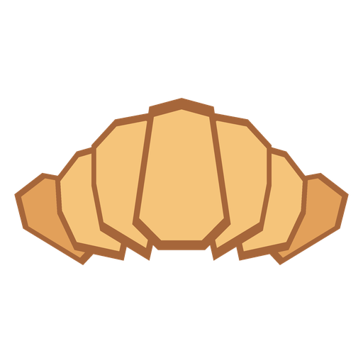
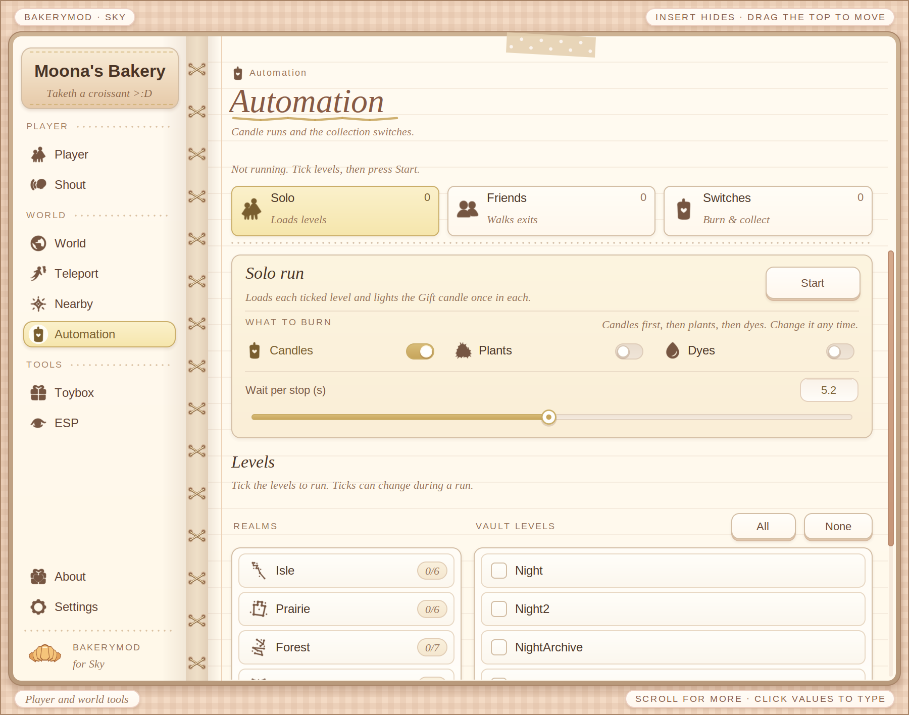
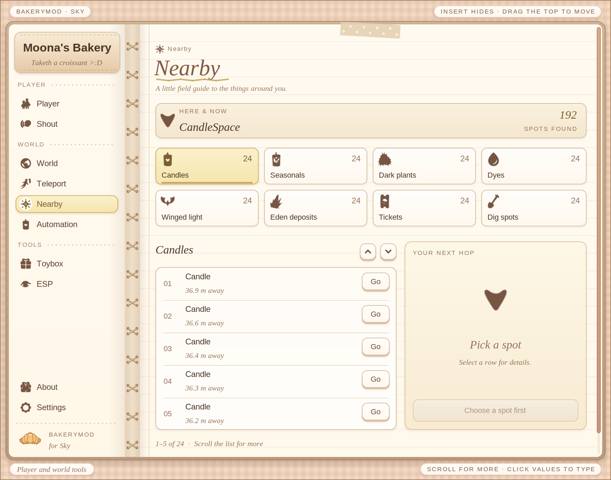
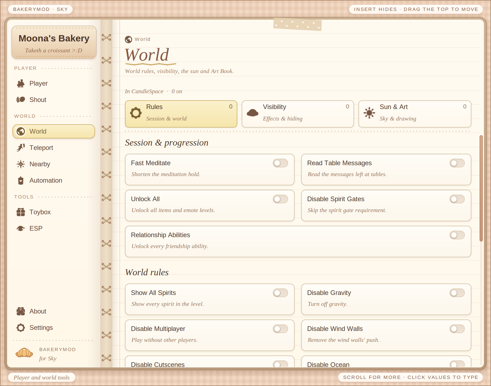
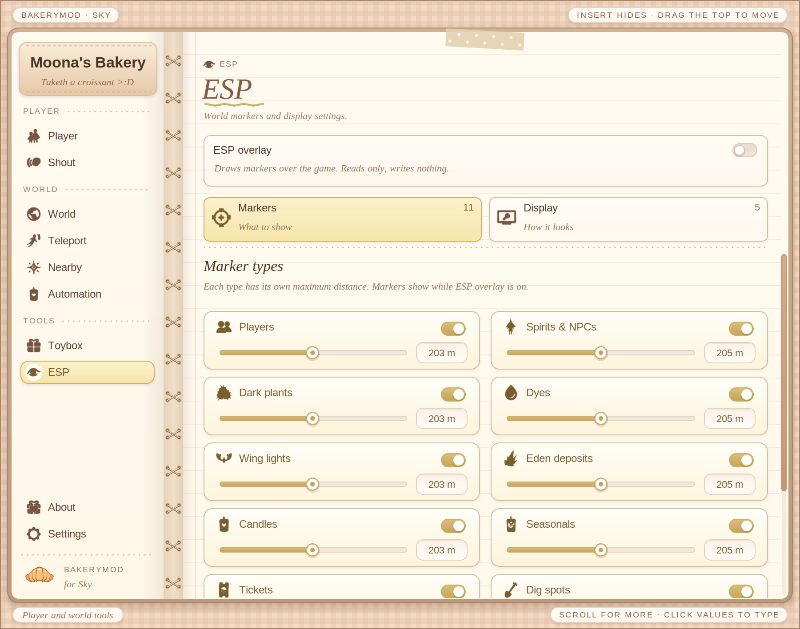
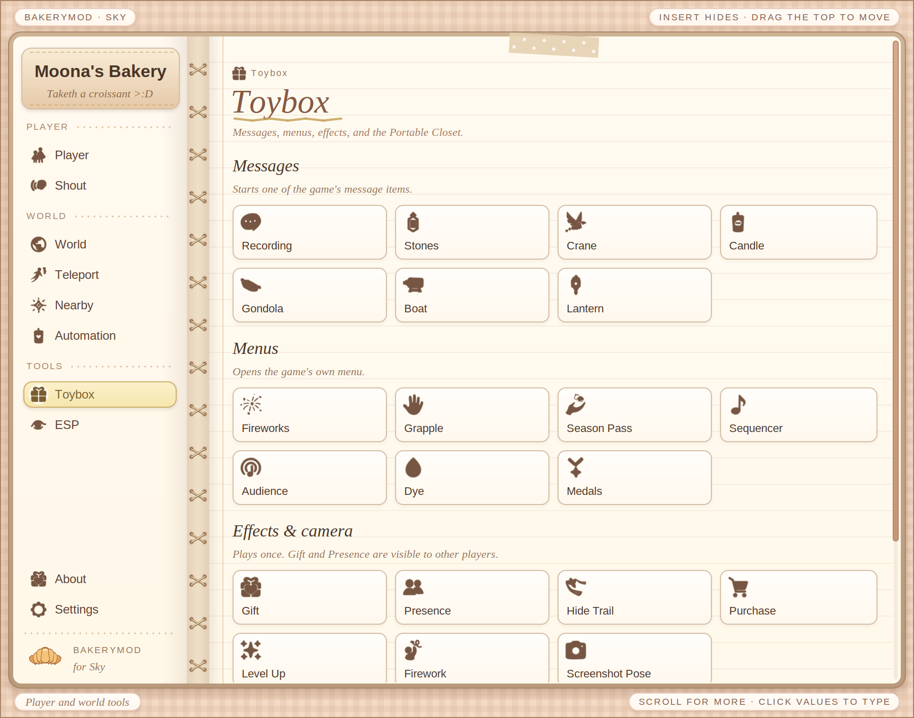
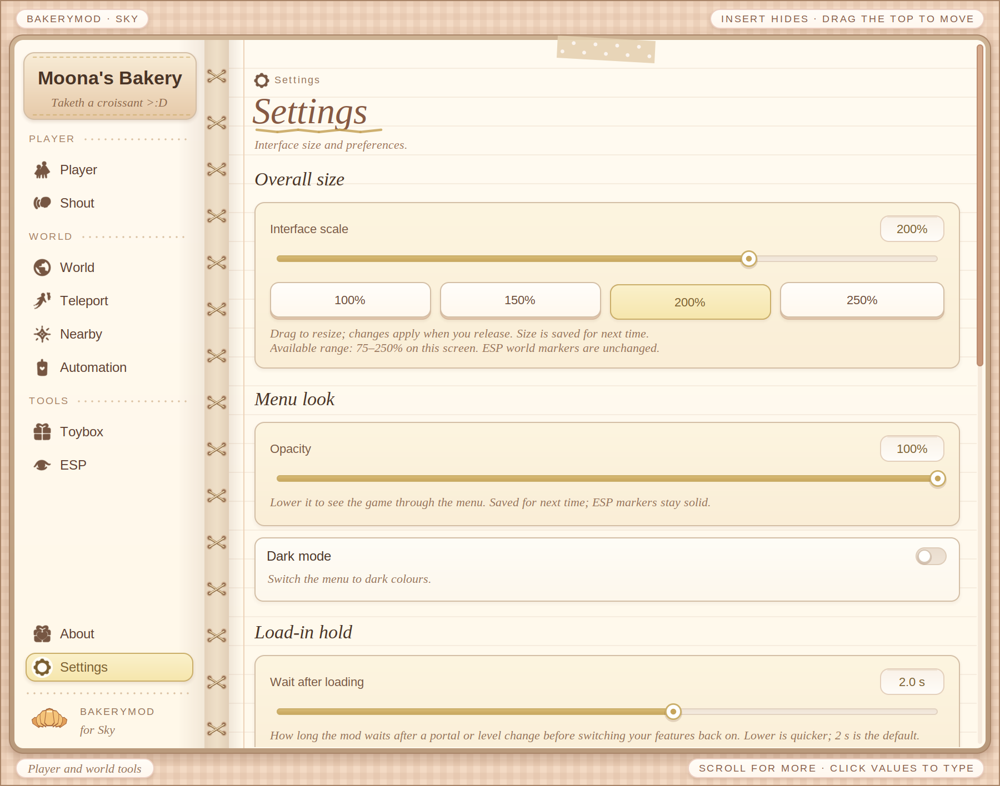

  

<h1 align="center">Moona's Bakery</h1>

  <b>A free mod menu for Sky: Children of the Light on PC, baked fresh by yours truly.</b>

  
  
  
  
  

  <a href="../../releases/latest"><b>Download</b></a>
  &nbsp;&bull;&nbsp;
  <a href="#a-peek-inside"><b>Screenshots</b></a>
  &nbsp;&bull;&nbsp;
  <a href="#how-to-use-it"><b>How to use it</b></a>
  &nbsp;&bull;&nbsp;
  <a href="https://discord.gg/xpdDNs3nga"><b>Discord</b></a>
  &nbsp;&bull;&nbsp;
  <a href="../../issues"><b>Report a bug</b></a>

> [!IMPORTANT]
> **Moona's Bakery is free. It always has been.** If you paid for it, you got scammed!!
> The only official places are this repo and my [Discord](https://discord.gg/xpdDNs3nga).

> [!NOTE]
> Works with Sky **0.35.2.426499** (Steam, Windows).
> If Sky has updated since then, I will know! So you only have to wait for a new release!

---

## Fresh from the oven

<table>
  <tr>
    <td width="33%" valign="top">
      <h3>Candle Runs</h3>
      A semi-auto run that goes realm by realm. It lights candles, burns plants and grabs dyes. Solo, or with Friends!
    </td>
    <td width="33%" valign="top">
      <h3>Nearby &amp; ESP</h3>
      A numbered list of everything around you, with matching markers that turn into pointers when they're off-screen.
    </td>
    <td width="33%" valign="top">
      <h3>Portable Closet</h3>
      Open the closets from anywhere, with a reach slider so it only grabs what you want.
    </td>
  </tr>
  <tr>
    <td valign="top">
      <h3>Teleport</h3>
      Every level, the Aviary portals, your own saved spots, and <b>Watch</b> to follow another player's camera.
    </td>
    <td valign="top">
      <h3>World</h3>
      Move the sun and moon, the Art Book look, glow and dim, and Unlock All for the friendship tree.
    </td>
    <td valign="top">
      <h3>Fully redesigned</h3>
      Every page was rebuilt. Click any number to type it in. Dark mode and a size slider are in Settings.
    </td>
  </tr>
</table>

---

## A peek inside

<table>
  <tr>
    <td width="50%">
<b>Automation</b> candle runs, solo or with friends
</td>
    <td width="50%">
<b>Nearby</b> find candles, plants, dyes and more
</td>
  </tr>
  <tr>
    <td>
<b>World</b> world rules, visibility, sun and Art Book
</td>
    <td>
<b>ESP</b> markers for everything around you
</td>
  </tr>
  <tr>
    <td>
<b>Toybox</b> messages, hidden menus, effects
</td>
    <td>
<b>Settings</b> size, opacity, dark mode, keys
</td>
  </tr>
</table>

---

## What's on the menu

<b>Player</b>

 

| | |
|---|---|
| **Movement** | Super Flight, Super Run, Super Jump, Super Launch, SuperSlidey and Fast Flap, each with a slider (click any value to type it in) |
| **Modes** | Crawl Mode, Scooter Mode |
| **Protection** | Infinite Energy, No Drain, Infinite Oxygen, Anti Krill, Anti AFK, Free Zoom |
| **Elder armor** | Armor Immunity, Repair Elder Armor, Break Elder Armor |
| **Appearance** | Fake Cape Level, Remove Cape, iOS Headphones, Unlimited Fireworks, Spell Emitter |
| **Avatar effects** | Rainbow, Spirit Shader, Inner Glow, Tattered Cape, Eden Glider, Child of Light |
| **Forms** | Cat, Chibi, Crab, Rainbow Trail, Husk Look, Bounce |
| **Extras** | Unlight Avatar, Kill Avatar |

<b>World</b>

 

| | |
|---|---|
| **Rules** | Fast Meditate, Read Table Messages, Unlock All, Relationship Abilities, Game Speed, Prevent Session Split |
| **Disable** | Spirit Gates, Wind Walls, Cutscenes, Gravity, Multiplayer |
| **Players** | Show All Spirits, Light All Players, Reveal All Players, Hide Other Players, Birthday Krills |
| **Visibility** | Hide the clouds, terrain, ocean, objects, models, candle flames and more |
| **Effects** | World Glow, World Dim, Black & White, Surreal Blue |
| **Sun & Art** | Move the sun and moon live, the Art Book look (with a "Dear Van Gogh" reset), Giant Flowers, Freeze Time |

<b>Teleport</b>

 

- Jump to places in every level, including the Aviary portals and a few out-of-bounds spots
- Load any level, with Portal mode and fade options
- Type in coordinates, save your own spots, Go Back, Reload, and a Nudge Pad for small hops
- **Players here:** see who's around and hop over to them, or **Watch** them with their camera
- Title Gate

<b>Nearby</b>

 

- A numbered list of candles, seasonals, dark plants, dyes, winged light, Eden deposits, tickets and dig spots, with how far away each one is
- Pick one and teleport right to it

<b>Automation</b>

 

| | |
|---|---|
| **Candle Run** | Tick the levels, pick what to burn (candles, plants, dyes), and it does the rest |
| **Solo** | Loads each level for you |
| **Friends** | Walks through the exits, realm by realm, so your friends come with you |
| **Switches** | Auto Burn Candles / Plants / Dyes, Faster Plant Burning, Auto Collect Wax, Auto Collect Fragments |

<b>Toybox</b>

 

| | |
|---|---|
| **Messages** | Recording, Stones, Crane, Candle, Gondola, Boat, Lantern |
| **Hidden menus** | Fireworks, Grapple, Season Pass, Sequencer, Audience, Dye, Medals |
| **Effects & camera** | Gift, Presence, Hide Trail, Purchase, Level Up, Firework, Screenshot Pose |
| **Closet** | Portable Closet: open the closets from anywhere |

<b>ESP</b>

 

- Markers for players, spirits & NPCs, dark plants, dyes, wing lights, Eden deposits, candles, seasonals, tickets, dig spots and krill
- Every type has its own max distance, and turns into a pointer when it's off-screen
- Labels (numbered like the Nearby list), distance, guide lines, glow, scale by distance, overlay and text size

<b>Settings</b>

 

- Remembers your toggles between sessions
- Menu size (75-250%), opacity and **Dark mode**
- Change the menu key, the candle run keys and the Watch key
- Reset buttons for when you mess something up ^^

---

## How to use it

| Step | What to do |
|:---:|---|
| **1** | Grab the newest **`MoonasBakery-vX.X.X.exe`** from the [Releases](../../releases/latest) page. |
| **2** | Run it. Windows will probably warn you, because the loader isn't code-signed. Click **More info → Run anyway**. |
| **3** | Pick a folder for the mod. It makes a `Moona's Bakery` folder in there. |
| **4** | Hit **Play Sky**, or **Wait for Sky** and start Sky yourself. The loader does the rest. |
| **5** | In game, press **Insert** to open the menu (you can change this key in the loader or in Settings). |

> [!TIP]
> Updating? Just run the new one. It remembers your folder, menu key and saved toggles.
> The menu will also tell you when a new version is out!

---

## Please read

> [!WARNING]
> Modding breaks Sky's Terms of Service. **You use this at your own risk**, and your account is your responsibility.

- This mod is **not affiliated with or endorsed by thatgamecompany**.
- I only add features I've tested myself.
- **Windows only** for now. Linux/Proton isn't supported (yet!).
- When Sky updates, the mod stops working until I put out a new build. Watch this repo to get notified.

<b>About the anonymous ping</b>

 

On launch, the loader sends an anonymous ping with a random install ID so I can see how many people use the mod, and asks for the newest version number so the menu can tell you about updates. No name, no account, just the mod version, no IP logged... just a number for me to look at.

---

## Found a bug?

Open an [Issue](../../issues) and tell me:

- what you were doing
- what happened vs. what you expected
- your Sky version (it's on the loader screen)
- if the game crashed, attach `BakeryCrash.log` from your `Moona's Bakery` folder (it's plain text, no personal info)

---

  <b>Oh, and feel free to join my Discord server!!</b> 
  Although, it's still new-  
  

